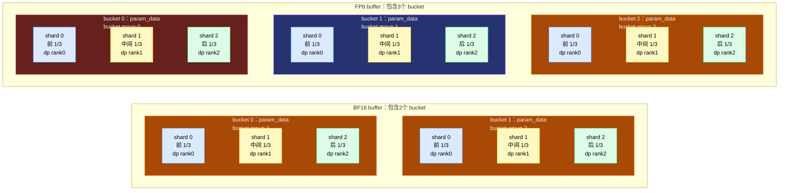

`Megatron` 的 `DDP` 方案为了高效同步模型参数/梯度，设计了分桶通信，涉及四种概念：
- `buffer`
- `bucket`
- `bucket group`
- `shard`
学习 `Megatron` 源码时，我对它们各自的作用，以及之间的关系颇感困惑。所以在这里记录下我的理解。

本文基于 `NVIDIA/Megatron-LM` 提交 `4828d651e768da5e3a833f8dbfc4dbec76f3fcdf` 的源码进行分析。该提交时间为 2026 年 7 月 3 日，`Megatron Core` 版本为 `0.19.0`。

本文主要分析标准 `Megatron DDP + Distributed Optimizer` 路径，`CP=1`、无专家参数、单优化器实例，不讨论 `layer-wise` 优化器及特殊缓冲区复用路径。
## 为什么要分桶？分桶如何改善`DDP`通信效率？
我认为分桶的核心目的是缩小参数/梯度通信的粒度，为通信与计算重叠创造条件。
#### 不使用梯度分桶
- 在不使用梯度分桶的情况下，需要等待所有参数的梯度就绪后，才能发起 `all-reduce/reduce-scatter` 通信。
#### 使用梯度分桶 开启`overlap_grad_reduce`
- 使用梯度分桶的情况下，不必等待所有参数梯度就绪。只要有某个桶组内的梯度完成计算，就可以先行发起 `reduce-scatter` 通信。此时其余桶组未完成的梯度计算还在进行中。通过梯度分桶，提供通算重叠机会。
## 四个概念各自在分桶通信过程中扮演的角色
### `buffer`
- `buffer` 用于组织同类参数或梯度的连续存储。需要区分 `_ParamAndGradBuffer` 管理对象与它持有的 `param_data`、`grad_data` 存储。
- `_ParamAndGradBuffer` 管理同一类别参数的连续存储布局。在标准 `Distributed Optimizer` 路径下，它通常分别持有连续参数存储 `param_data` 和连续梯度存储 `grad_data`；二者不是同一块显存。
- 每个 `DP rank` 都在自己的 `GPU` 上分配本地 `buffer`；“完整”指当前 `TP/PP` 划分后的本地 `model chunk`，而非全局模型。
- 不同类别的参数/梯度各自被集中存放在若干`buffer`内。用来区分类别的`BufferKey` 同时考虑参数存储 `dtype`、梯度 `dtype`、是否专家参数、是否由 `layer-wise` 优化器管理。
### `bucket`
- `Megatron` 通常按接近反向计算的参数顺序组织布局，将完整参数依次放入桶；达到 `bucket_size` 阈值后结束当前桶。`bucket_size` 是目标阈值，不是严格上限，也不保证各桶大小接近。
- `bucket`的划分边界尊重参数边界。也就是说不会存在某个模型参数的前一半位于`bucket A`，后一半位于`bucket B`的情况。
### `bucket group`
- `Megatron` 按配置选择若干 `bucket` 组成 `bucket group`。同一个 `group` 可能包含来自不同 `buffer` 的 `bucket`。
- `DDP` 梯度同步通信的发起单位是 `bucket group`，而不是 `bucket`。也就是说只有某个 `bucket group` 内所有相关参数的本轮梯度贡献累积完成，才会以 `bucket group` 为单位发起通信。
- `bucket group` 是就绪判断和派发单位，但不一定只有一次通信。桶组统一判断就绪并组织通信，但通信调用仍逐个处理 `bucket` 的 `tensor`。
### `shard`
- `bucket` 经过对齐填充（`padding`）后的区间，按 `DP` 组大小等分为连续 `shard`；组内 `rank` `r` 负责第 `r` 个 `shard`。
- `shard` 的边界不尊重参数边界。也就是说可能会存在某个模型参数的前一半位于`shard A`，后一半位于`shard B`的情况。

## 图示
- 以 DP size=3 为例。
- 使用常规 FP8 合组规则，未强制单组，也未开启特殊 FP32 累积 reduce-scatter 路径。
- 图只展开 `param_data`，没有画独立的 `grad_data`。
- 图示为任意一个 DP rank 的本地参数 buffer 布局；所有 shard 区间均在该 GPU 上分配，rank 标签表示更新职责。

